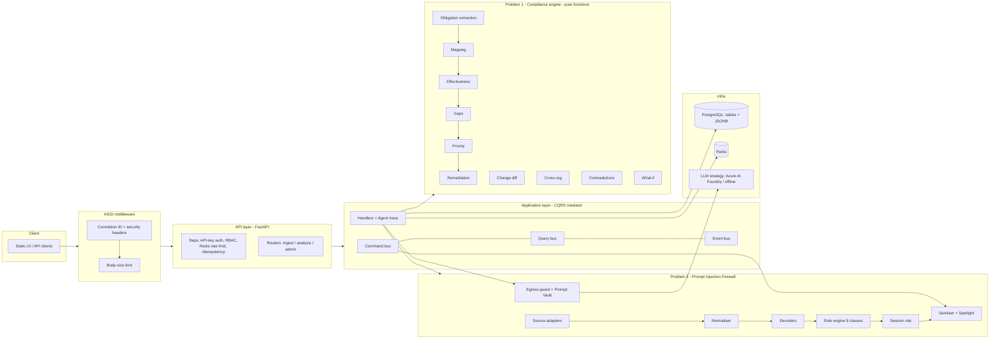

# Architecture

A **modular monolith**: one deployable FastAPI process, strict internal layering, no microservices. Each module could be extracted later because dependencies only point inward.

## Request lifecycle: ingest a regulation

1. Middleware: validate/mint **correlation id**, enforce body limit, add security headers.
2. Deps: authenticate (constant-time hash compare) → RBAC (`analyst`) → **rate limit** (Redis `INCR` window) → **idempotency** (`SET NX` claim, replay on repeat).
3. `IngestDocument` command under a Redis **tenant lock**:
   - **Firewall Sentinel** scans → `block` ⇒ quarantine (hash only) + audit + 422; `sanitize` ⇒ redacted visible text only.
   - **Extraction Agent** parses obligations/controls/evidence (rejects non-binding or malformed documents).
   - **Ingestion Agent** encrypts (AES-GCM) and persists with an audit entry in one transaction (Unit of Work).
   - **Impact Analysis Agent** analyses state *before* and *after* (read-model snapshot), diffs regulation versions, stores an impact report (JSONB).
   - **Monitoring Agent** appends a compliance snapshot to the trend.
4. Event `document.ingested` published (in-process subscribers + Redis pub/sub).
5. Response includes the **agent trace** (agent, action, outcome, ms) tagged with the correlation id.

## Where each pattern is used

| Pattern | Location | Why |
|---|---|---|
| **Singleton** | `core/config.get_settings` (cached), `infra/db.Database.instance`, `infra/redis_client` client, `firewall/egress.vault` | one pool / one config per process |
| **Repository** | `infra/repositories/*` (documents, audit, docstore) | persistence hidden from handlers; tenant isolation enforced at the repository |
| **Unit of Work** | `infra/uow.py` | one transaction across repositories (doc + audit commit atomically) |
| **Strategy** | `firewall/extract.py` (per-source extractors), `firewall/decode.py` (decoder set), `firewall/rules.py` (per-class rules), `llm/providers.py` | add a source/decoder/rule/model without touching the engine |
| **Factory** | `llm/factory.build_provider`, `container.build_container` | choose Foundry vs offline from config |
| **Mediator / CQRS** | `cqrs/bus.py` + `handlers.py` | writes (PostgreSQL) separated from reads (Redis-cached snapshots) |
| **Domain events / Observer** | `cqrs/bus.EventBus` | decouple "ingested" from monitoring/notifications |
| **Pipeline / Chain of responsibility** | firewall stages; compliance `analyze()` | each stage has one job and is unit-tested |
| **Pure functional core** | `compliance/engine.analyze` | what-if and impact analysis are the same function on different inputs → trustworthy and trivially testable |
| **Idempotent receiver** | `api/deps.idempotent` | safe client retries |
| **Distributed lock** | `infra/redis_client.tenant_lock` | serialise tenant writes across instances |
| **Dependency injection** | `Container`, FastAPI `Depends` | testability |
| **Audit hash chain** | `infra/repositories/audit.py` | tamper evidence |

## CQRS read model

Commands write PostgreSQL. Queries read an **analysis snapshot** in Redis keyed `analysis:{tenant}:{fingerprint}` where the fingerprint = hash(document ids + content hashes + bank profile + date). Any write changes the fingerprint ⇒ automatic invalidation with no explicit cache-busting; a Redis flush just causes recomputation. `readModelCache: hit|miss` is exposed to show it working.

## Redis roles

| Use | Keys |
|---|---|
| Idempotency records | `idem:{tenant}:{scope}:{key}` |
| Rate limiting | `rl:{kind}:{tenant}:{actor}:{window}` |
| Firewall multi-step memory | `fw:sess:{tenant}:{session}` (list, TTL 1h) |
| CQRS read model | `analysis:{tenant}:{fp}` |
| Distributed locks | `lock:{tenant}:write` |
| Event fan-out | channel `regguard:events` |

## PostgreSQL (SQL + NoSQL in one engine)

* Relational: `documents` (encrypted payload, metadata, firewall verdict), `audit_log` (hash chain, unique `(tenant, seq)`).
* Document store (JSONB): `doc_store(tenant, collection, key, data)` for profiles, impact reports, compliance history, quarantine records – schemaless, indexed by `(tenant, collection)`.

## Reliability & failure behaviour

* Redis down → readiness `503`, rate-limit/idempotency fail closed (requests error rather than bypass safety). PostgreSQL down → `503` via readiness; transactions roll back via the Unit of Work.
* LLM provider error → `503 DEPENDENCY_UNAVAILABLE` (typed), never a raw stack trace; offline deterministic analyst needs no external dependency.
* Failed idempotent attempts release the key so clients can retry.
* Concurrent identical requests: one executes, others get `409` (+`Retry-After`) or the replayed result.

## Self-assessment on the 3×3 grid (for the submission)

* **Problem 1 – Features: F3** (all 14 of 14 implemented; threshold is 8). **Depth: D2** — structured/textual input with demonstrable reliability (deterministic engine, 381 automated tests incl. one per feature, evidence-gated status, explainable scores). We do *not* claim D3: images/audio are only handled as OCR text and scanned PDFs are not OCR'd by us.
* **Problem 2 – Features: F3** (9 of 9 attack classes; threshold is 7). **Depth: D2** — textual sources plus hidden channels, measured on a labelled corpus. D3 (true multimodal) is not claimed: image content is accepted only as OCR text.
* Supporting features embedded: observability (correlation ids, structured logs, agent traces, audit chain), fault tolerance (idempotency, locks, typed errors, health probes), security (below), traceability, explainability.

## Honest limitations

* Obligation extraction and mapping are lexical/heuristic; they are fast, deterministic and explainable but will miss highly implicit obligations. The `LLMProvider` strategy is the extension point for an Azure AI Foundry model to *propose* richer extractions — which would still pass through the firewall and be validated by the deterministic engine.
* The firewall is rule-based; novel semantic injections can evade it. It is one layer among several.
* Sample regulations are fictional extracts for the demo, not legal text.
